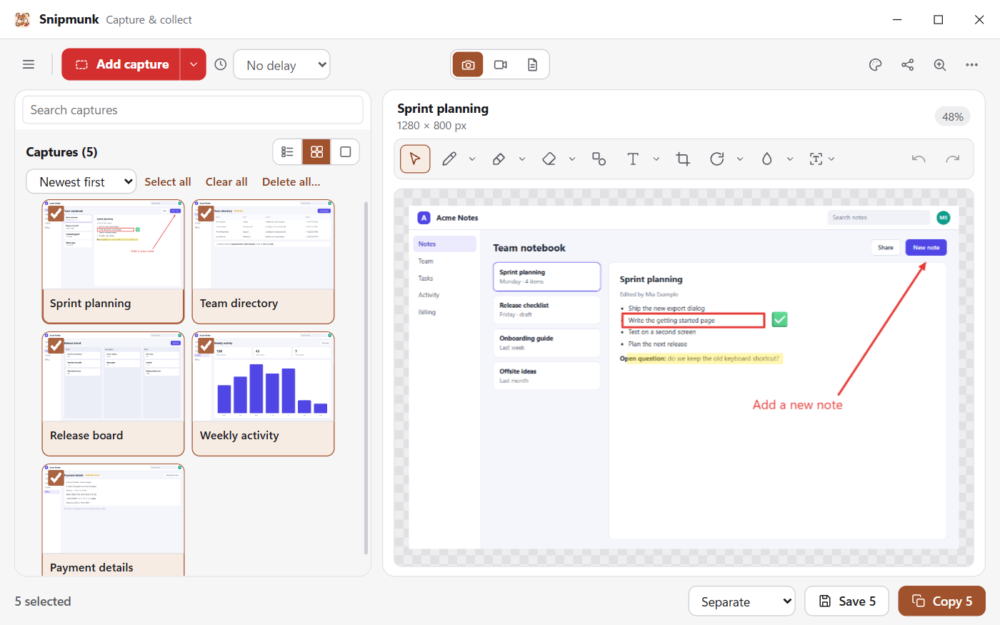
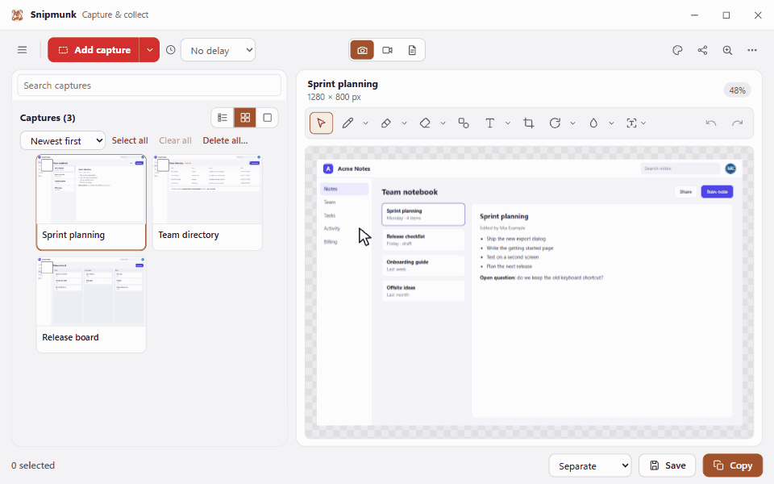
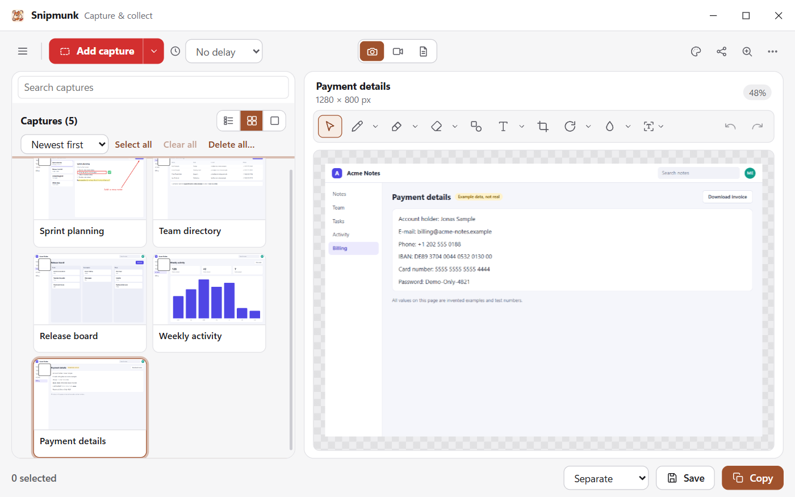
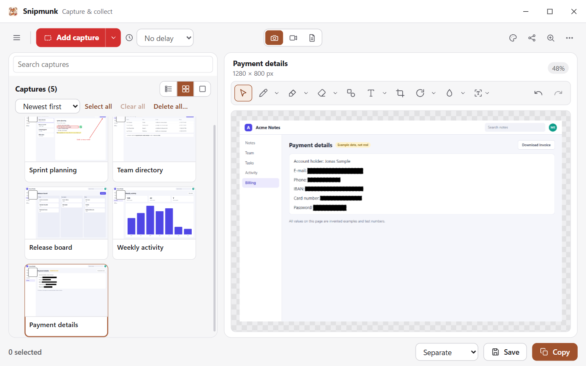
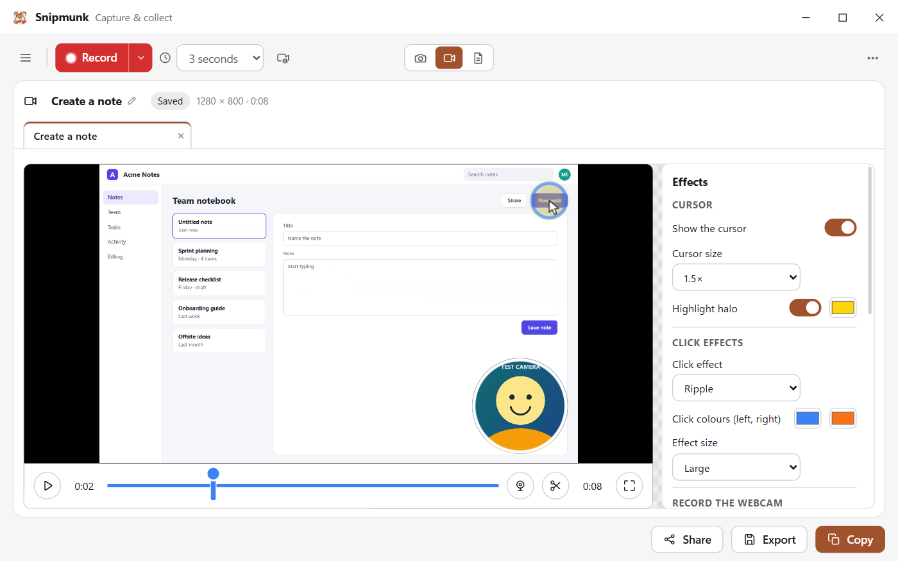
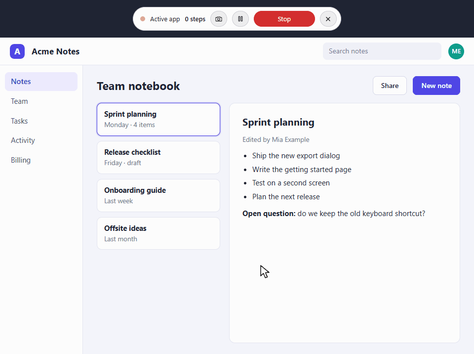

<p align="center">
  
</p>

<h1 align="center">Snipmunk</h1>
<p align="center"><b>Capture &amp; collect</b></p>

<p align="center">
  A free, open-source <b>screenshot clipboard</b> for Windows: capture many, mark them up, then paste all of them, or only the
  ones you select, in one go. Plus text recognition, quick redaction, screen recording and step-by-step guides.<br />
  Offline, no account, no telemetry.
</p>

<p align="center">
  <a href="https://github.com/Second-Dawn-Lab/snipmunk/releases/latest"></a>
  <a href="LICENSE"></a>
  
</p>

<h3 align="center"><a href="https://github.com/Second-Dawn-Lab/snipmunk/releases/latest">⬇ Download Snipmunk for Windows</a></h3>

<p align="center">
  <picture>
    <source media="(prefers-color-scheme: dark)" srcset="docs/media/main-window-dark.png" />
    
  </picture>
</p>

## Download

- **[Latest release](https://github.com/Second-Dawn-Lab/snipmunk/releases/latest)**: run `Snipmunk_x.y.z_x64-setup.exe`. It
  installs for your user account.
- **Requirements:** Windows 10 or 11, 64-bit, and Microsoft's WebView2. Windows 11 has WebView2 already; on Windows 10 the
  installer fetches it if it is missing ([details](docs/user-guide/faq.md#what-is-webview2-and-do-i-need-it)).
- **SmartScreen:** you may see **"Windows protected your PC"** or **"SmartScreen can't be reached"**. Click **More info**, then
  **Run anyway**. The installer is not code-signed yet; it is built on GitHub from the source code in this repository. Signing
  ([policy](docs/CODE_SIGNING_POLICY.md)) and a Microsoft Store version are planned.
- **Updates:** Snipmunk checks GitHub once a day and installs a new version only when you click **Update and restart**. The check
  can be switched off.

## Features

### 📷 Screenshots

<p align="center">
  
</p>

- Rectangle, window, full screen and freeform capture, with a delay, started with `Ctrl+Alt+PrintScreen`.
- Every capture lands in **one list** that survives restarts.
- Annotate: pen, highlighter, shapes, arrows, emoji, text, crop, rotate, blur, undo.
- **Copy** the selected captures **separately, stacked or as a grid**, or drag them out as files.
- Save as PNG, JPEG, WebP, BMP or ZIP; print; share; search by name and by the text in the picture.

[Screenshots guide](docs/user-guide/screenshots.md)

### 🔤 Text recognition and Quick redact

| Before | After one click |
|---|---|
|  |  |

- Copy all text, select text on the picture, or **copy a table**.
- **Quick redact** covers e-mail addresses, phone numbers, card numbers, IBANs, passwords and your own words.
- Copies and exports have the covered **pixels really replaced**; you can also erase them from the kept picture.
- Runs on your computer with Windows' own text recognition. Always check the result.

[Text recognition guide](docs/user-guide/text-recognition.md)

### 🎥 Screen recording

<p align="center">
  
</p>

- Record an area, a window or the full screen with **system sound, microphone and a webcam bubble**.
- Cursor highlight and click effects, adjustable **after** recording.
- Trim and split; export **MP4 or GIF**, in the shape you need (16:9, 9:16, 1:1).
- Copy or share the video; keep it as a `.snpr` project; interrupted recordings can be recovered.

[Recording guide](docs/user-guide/recording.md)

### 📄 Step-by-step guides

<p align="center">
  
</p>

- **Every click becomes a step** with a picture and an automatic text. Text typed into password fields is never stored.
- Edit steps; add text, images and tables; **callouts, spotlight and magnifier**.
- **Templates** with cover designs and contents, edited on real pages.
- Export to **PDF, Word, Markdown or HTML**; save as a `.snpd` file.
- **Quick redact a whole guide** before you share it.

[Guides](docs/user-guide/guides.md) · [Templates and export](docs/user-guide/templates-and-export.md)

## Lightweight

| State (all of Snipmunk's processes) | Memory in use |
|---|---:|
| Just started | about 85 MB |
| With 30 captures | about 100 MB |
| A 50-step guide open | about 177 MB |
| Minimized | about 17 MB |
| After closing | 0: it quits completely (unless you keep it in the tray) |

Private working set of a release build, measured on one Windows 11 computer; how, and more numbers:
[performance.md](docs/performance.md).

## Privacy and offline use

Everything stays on your computer: screenshots, recordings, guides and text recognition. No account, no telemetry, no upload.
**The only network request is the update check** (it asks GitHub for the version information and sends nothing about you), plus
the download of an update you choose to install. See the [privacy policy](PRIVACY.md) and
[where your files are](docs/user-guide/files-and-privacy.md).

## Languages

English, German, Spanish, French, Italian, Dutch, Polish, Turkish, Simplified Chinese, Traditional Chinese, Arabic and Urdu,
with a right-to-left layout for Arabic and Urdu. The translations are AI-generated for now;
**help from native speakers is very welcome**.

## Documentation

| | |
|---|---|
| **[User guide](docs/user-guide/index.md)** | Every mode, step by step |
| [Keyboard shortcuts](docs/user-guide/shortcuts.md) | All shortcuts on one page |
| [FAQ](docs/user-guide/faq.md) | SmartScreen, WebView2, shortcuts, microphone, bug reports |
| File formats | [.snpr recordings](docs/snpr-format.md) · [.snpd guides](docs/snpd-format.md) · [.snpt templates](docs/templates.md#own-templates-and-the-file-format-snpt) |
| [Roadmap](docs/ROADMAP.md) | What is done and what comes next |

## Contributing

Bug reports, ideas, translations and pull requests are welcome: [open an issue](https://github.com/Second-Dawn-Lab/snipmunk/issues)
and see [CONTRIBUTING](https://github.com/Second-Dawn-Lab/.github/blob/main/CONTRIBUTING.md) and the
[Code of Conduct](CODE_OF_CONDUCT.md). To report a vulnerability, follow [SECURITY.md](SECURITY.md).

<details>
<summary><b>Build from source</b></summary>

### Prerequisites

Windows, Node.js 20+, [pnpm](https://pnpm.io), Rust (stable) and the [Tauri prerequisites](https://tauri.app/start/prerequisites/).

### Get the code

Snipmunk uses the shared code in [`dawn-core`](https://github.com/Second-Dawn-Lab/dawn-core), which must sit **next to** this
folder (the version in `dawn-core.ref`).

```text
SecondDawn/
  dawn-core/
  snipmunk/     <- this repo
```

```bash
git clone https://github.com/Second-Dawn-Lab/dawn-core
git clone https://github.com/Second-Dawn-Lab/snipmunk
cd dawn-core && pnpm install
cd ../snipmunk && pnpm install
```

### Run and check

```bash
pnpm tauri dev      # or run-snipmunk.bat on Windows
pnpm dev            # UI alone in a browser with a mock backend (src/ipc.mock.ts); add ?window=settings
pnpm lint && pnpm typecheck && pnpm test
cargo fmt -p snipmunk -p snipmunk-pixels -- --check
cargo clippy --workspace --all-targets && cargo test --workspace
```

- Release process: [docs/releasing.md](docs/releasing.md). Microsoft Store package: [docs/store.md](docs/store.md).
- The screenshots and GIFs of the documentation: [docs/media/README.md](docs/media/README.md).

</details>

## License

Snipmunk is MIT licensed. See [LICENSE](LICENSE).

## Part of Second Dawn

Snipmunk is a [Second Dawn](https://github.com/Second-Dawn-Lab) app. Second Dawn builds free, open-source desktop apps that run
on your own computer. Also from Second Dawn: [Owl-L](https://github.com/Second-Dawn-Lab/owll), an offline translator.
