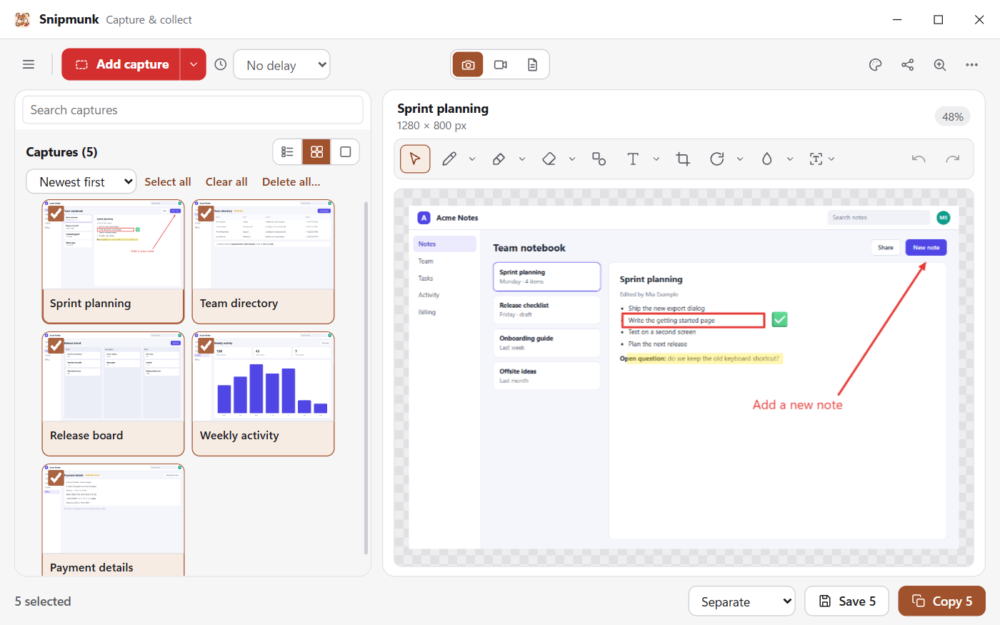
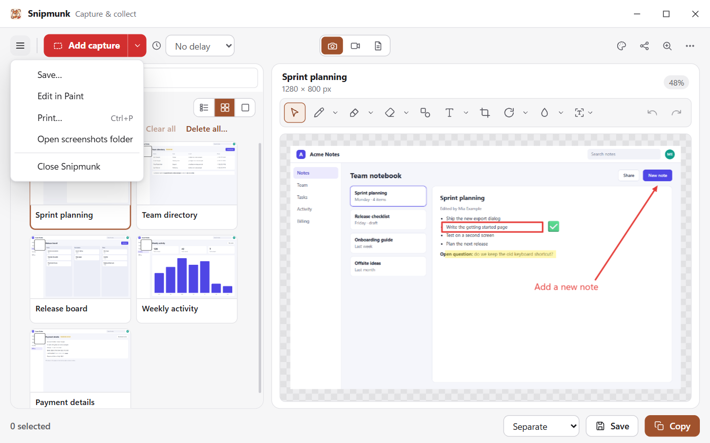

# Getting started

[Guide overview](index.md)

## Install

You need 64-bit Windows 10 or 11.

1. Download `Snipmunk_x.y.z_x64-setup.exe` from the [latest release](https://github.com/Second-Dawn-Lab/snipmunk/releases/latest).
2. Run it. If Windows shows **"Windows protected your PC"** or **"SmartScreen can't be reached"**, click **More info**, then
   **Run anyway**. See [why this happens](faq.md#why-does-windows-warn-me-about-the-installer).
3. Follow the installer. It installs for your user account only. At the end you can add a desktop shortcut.

Snipmunk uses Microsoft's **WebView2**. Windows 11 has it already; on Windows 10 the installer fetches it if it is missing
([more](faq.md#what-is-webview2-and-do-i-need-it)).

## First start

The window has the same layout in every mode:

| Where | What |
|---|---|
| Top left | The **File menu** (☰) and the main button of the mode: **Add capture**, **Record** or **New guide** |
| Top middle | The **mode switch** |
| Top right | **⋯** (More): Settings and, for screenshots, Zoom and Open file |
| Bottom | What you can do with the result: copy, save, share or export |

In Arabic and Urdu the layout is mirrored.

## The three modes

| Mode | Use it for | Start with |
|---|---|---|
| 📷 **Screenshots** | Collect many captures, annotate them, paste them all at once | **Add capture** or `Ctrl+Alt+PrintScreen` |
| 🎥 **Recording** | Record an area, a window or the full screen | **Record** or `Ctrl+Alt+R` |
| 📄 **Documents** | Turn what you do into a step-by-step guide | **New guide** or `Ctrl+Alt+G` |

The shortcuts work in any program while Snipmunk is running. You can change them in [Settings](settings.md).

## The File menu

The ☰ button holds what you can do with the thing on show. It changes with the mode:

| Screenshots | Recording | Documents |
|---|---|---|
| Save… | Open project… | New guide, Open guide… |
| Edit in Paint | Save / Save as… / Save as project… | Save, Save as… |
| Print… | Rename, Show in File Explorer | Rename, Show in File Explorer |
| Open screenshots folder | Close project / Discard recording… | Close guide |
| | Recent projects | Recent guides |

Every File menu ends with **Close Snipmunk**.

## Settings

Open **⋯ → Settings**. The search box at the top of the settings window finds a setting by name and jumps to it.
Every page is described in [Settings](settings.md).

## Closing, the tray and start with Windows

By default, closing the window **quits** Snipmunk completely: no background process stays. If a recording or a guide is not
saved, Snipmunk asks first.

To keep the shortcuts ready while the window is closed, choose **Settings → General → When the window is closed**:

- **Quit Snipmunk** (default)
- **Keep running in the tray**: closing hides the window; an icon in the notification area opens it again
- **Ask me**: choose each time

The tray icon's menu has **Open Snipmunk**, **Add capture**, **Record**, **New guide**, **Settings** and **Quit**.

**Start with Windows** is off by default (Settings → General). When on, Snipmunk starts at sign-in, minimized, or in the tray if
you keep it there.

## Updates

Snipmunk updates itself from GitHub Releases:

- It checks **once a day** after a start. Only the version information is requested.
- When a new version exists, a notice offers **Update and restart**. Nothing is installed without your click, and unsaved work
  is asked about first.
- Check by hand with **Settings → About → Check for updates**, or switch **Check for updates automatically** off there.

A Microsoft Store version is planned; the Store will update that one.

Next: [Screenshots](screenshots.md)
