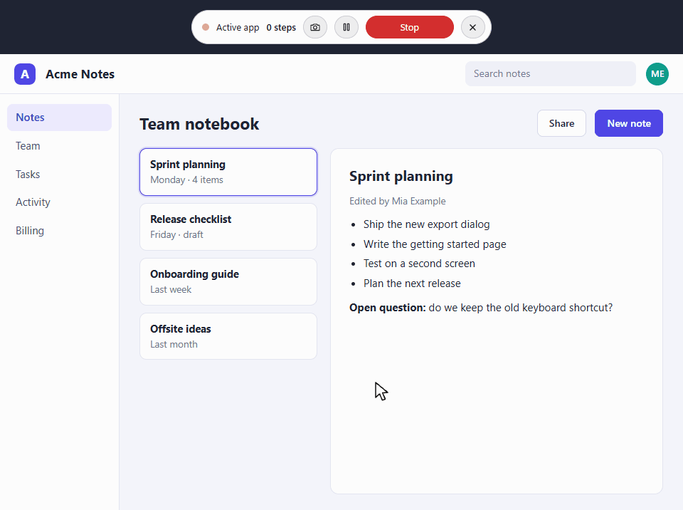
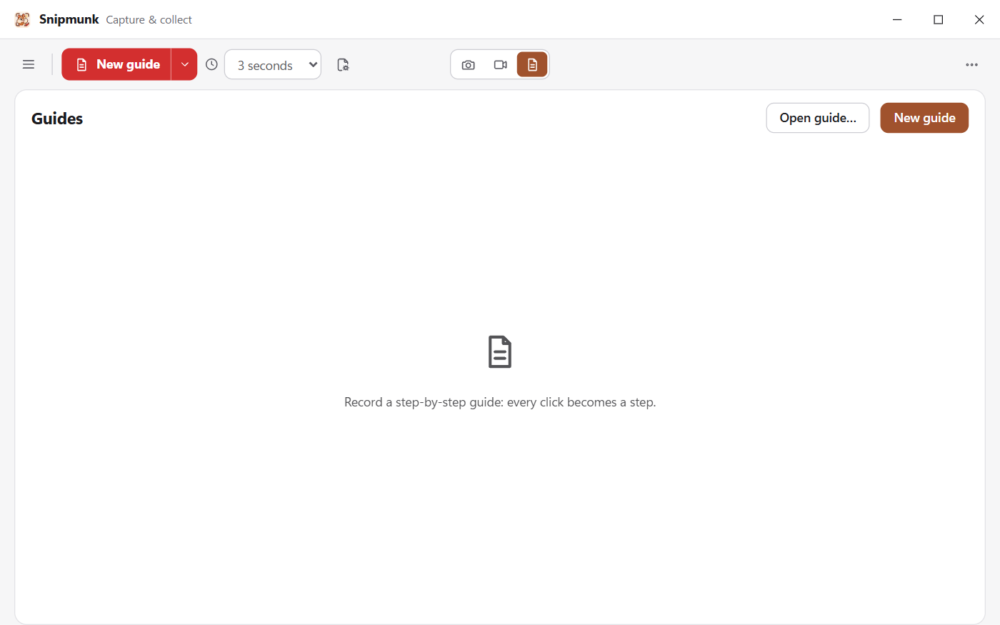
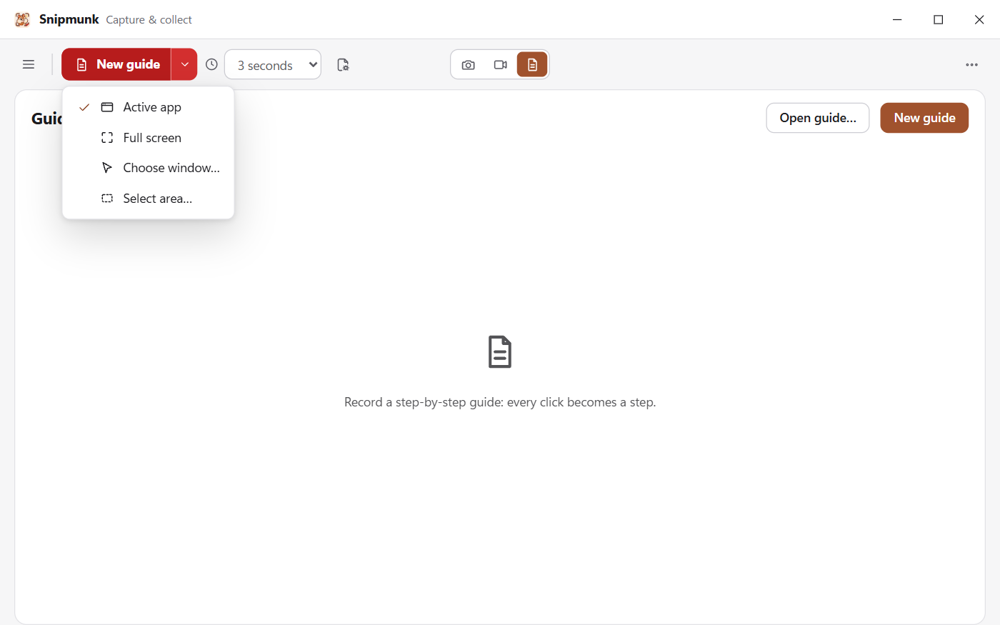
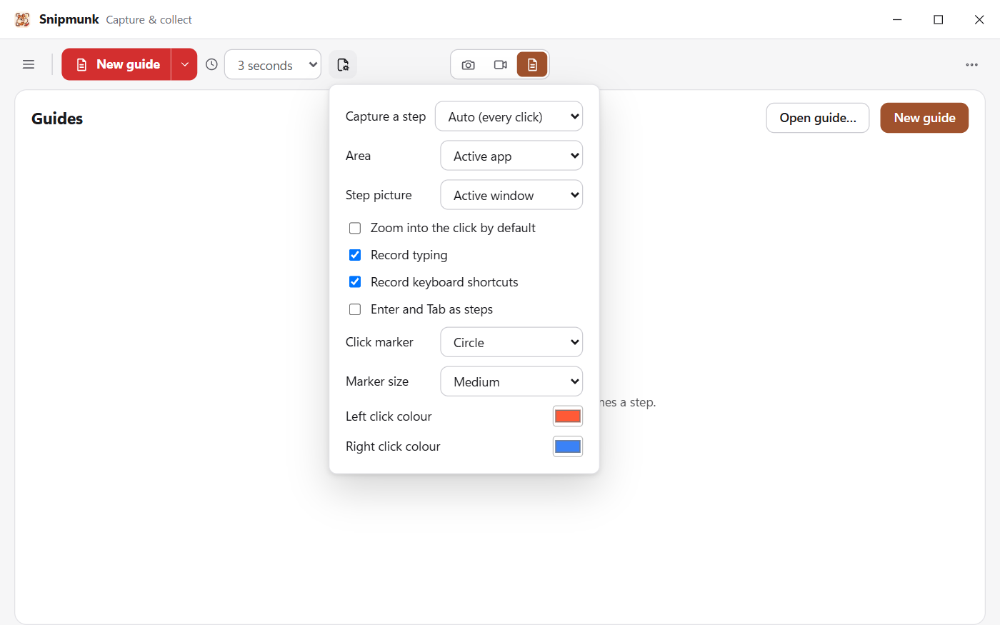
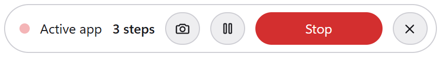
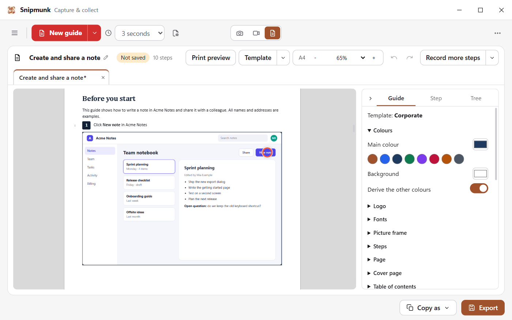
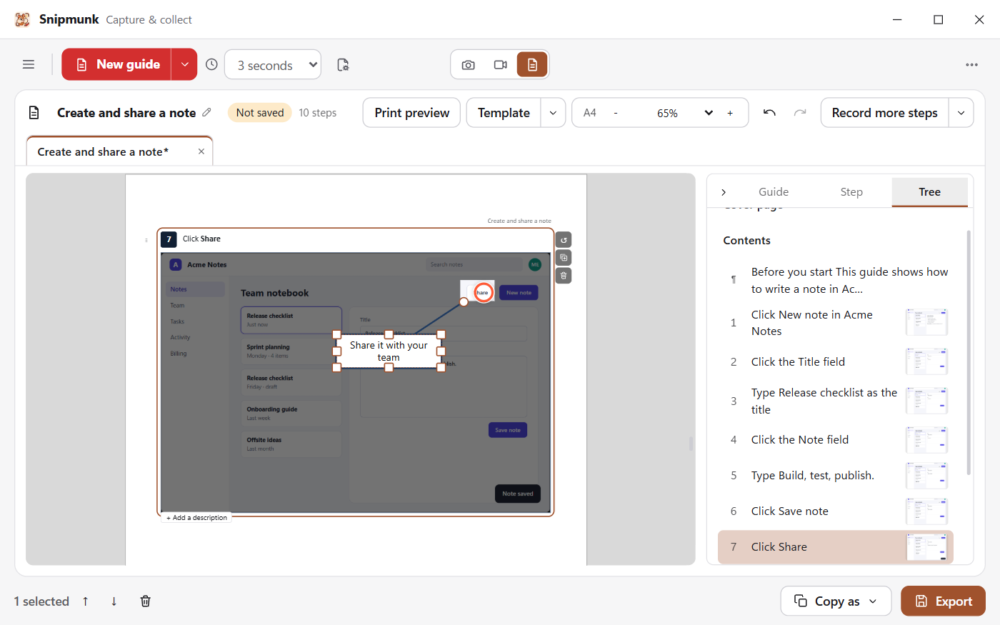
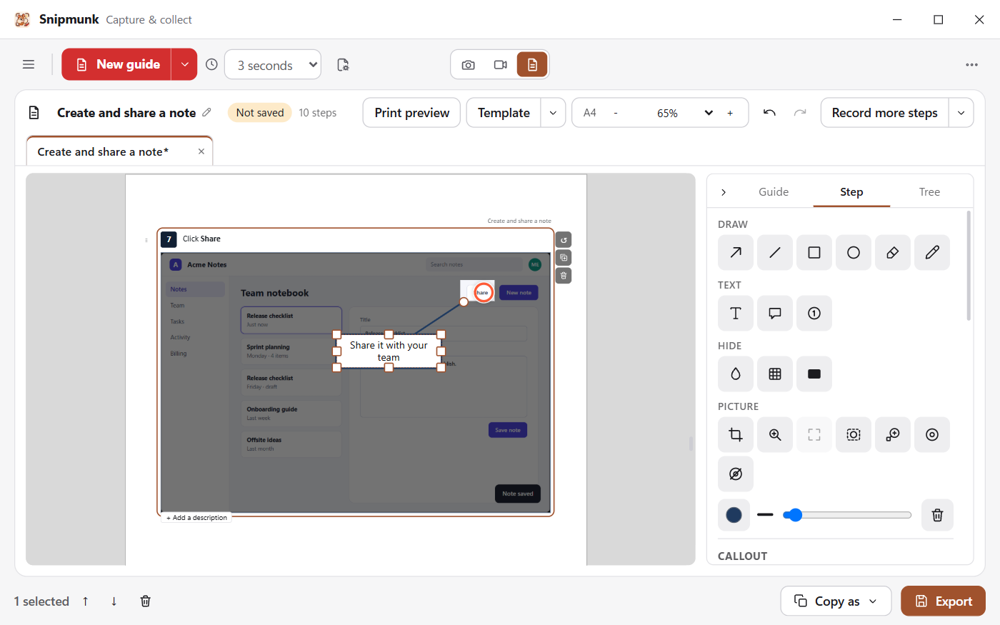
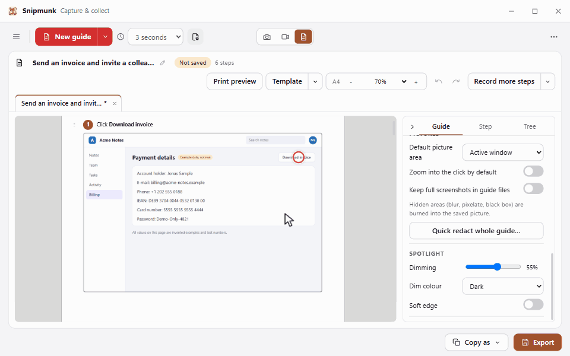
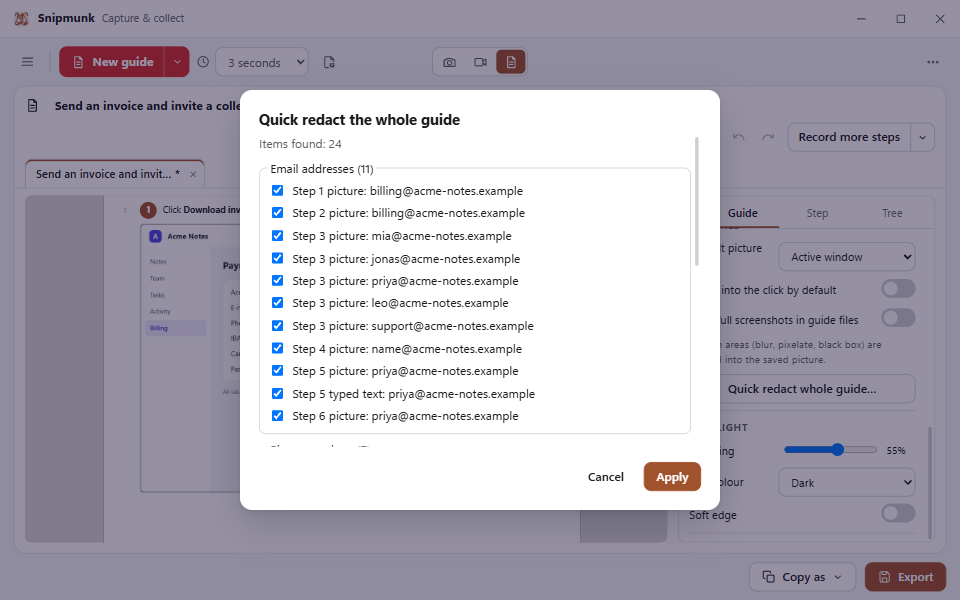

# Step-by-step guides

[Guide overview](index.md)

Snipmunk writes the guide while you work: **every click becomes a step**, with a picture and a sentence such as
*Click **Save note***. Switch to the **Documents** mode (📄).

## Start a guide

1. Click **New guide**, or press `Ctrl+Alt+G` in any program.
2. A countdown runs (the one from Settings → Recording; `Esc` cancels).
3. Do your task. Stop with the bar's **Stop** button.

### What to record

Choose with the arrow next to **New guide**:

| Area | Steps are made for |
|---|---|
| **Active app** | Every click; each picture shows the window you worked in |
| **Full screen** | Every click; pictures show the whole monitor |
| **Choose window…** | Only clicks in that window |
| **Select area…** | Only clicks inside the area; pictures are cut to it |

With a window or an area, a frame shows it, clicks outside are ignored and the bar says how many.

### Auto or manual steps

- **Auto** (default): every click is a step.
- **Manual:** a step is taken only when you press `Ctrl+Alt+S` or the bar's **Take step** button.

`Ctrl+Alt+S` takes an extra step in Auto mode too. The button next to the countdown holds these quick settings:

### The guide bar

**Pause** stops all recording until you resume. **Cancel** deletes the steps, after a question. Clicks on the bar and on
Snipmunk's own windows are never steps.

### Typing and passwords

- Text typed into one field becomes **one step**. Shortcuts with `Ctrl`, `Alt` or `Win` become steps such as *Press Ctrl+C*.
  Enter and Tab become steps only if you switch that on.
- **Text typed into a password field is never stored.** The step shows dots, and its picture is the one from before you typed. The
  same happens when Snipmunk cannot check the field in time.
- A password typed where there is no recognisable password field (a terminal, an unusual program, a "show password" box) **is**
  recorded like other text, and pictures show what is on screen. Check a guide before you share it, hide what is private (below),
  or switch **Record typing** off in [Settings → Documents](settings.md#documents).
- Programs **running as administrator** cannot be recorded; the bar says so ([why](faq.md#steps-in-some-programs-are-missing)).

## The editor

When you stop, the guide opens as real pages.

### Steps and text

- Click a step's text to change it; **Reset to generated text** brings back the original. **+ Add a description** adds more
  explanation under the picture.
- The **+** between blocks inserts a **Text block**, an **image** (from a file or the clipboard), a **step** from a screenshot
  file or from a Snipmunk screenshot, or a **blank step**.
- Text blocks have formatting (headings, fonts, colours, highlight, lists, alignment, links), **tables** and resizable,
  croppable images.
- **Reorder** by dragging the ⋮ handle, or with `Alt+↑` / `Alt+↓`. `Ctrl`- or `Shift`-click selects several blocks;
  `Delete` removes them. `Ctrl+Z` / `Ctrl+Y` undo and redo everything.

### The sidebar

| Tab | Holds |
|---|---|
| **Guide** | The look of the whole guide: [template](templates-and-export.md), cover, pages, colours, click marker, step numbers, pictures |
| **Step** | The tools and settings of the selected step |
| **Tree** | An outline of the guide to jump, select and reorder |

### Mark up a step picture

Select a step, then open the **Step** tab. The letter chooses a tool, even with the sidebar folded.

| Group | Tools (key) |
|---|---|
| Draw | Arrow (`A`), Line (`L`), Rectangle (`R`), Ellipse (`E`), Highlight (`H`), Pen (`P`) |
| Text | Text (`T`), **Callout** (`O`), Number (`N`) |
| Hide | Blur (`B`), Pixelate (`X`), Black box (`K`) |
| Picture | Crop (`C`), Zoom area (`Z`), Expand area (`W`), **Spotlight** (`S`), **Magnify** (`G`), Move marker (`M`) |

- **Callout:** click, or drag from what it points at to where the box should be, and type. Choose the shape (rounded box,
  rectangle, speech bubble, oval, cloud, arrow label), colours, border and size. The box may stand beside the picture.
- **Spotlight:** drag an area; everything else is dimmed. Set the strength, colour and soft edge, and **apply to all steps** if
  you like.
- **Magnify:** drag an area; it is shown enlarged in a bubble, with a line to the place.
- `Delete` removes the selected mark. `Esc` puts away the tool, then the mark, then the selection.

### Zoom and picture area

- **Picture area:** *Guide default*, *Active window*, *Full screen* or a *custom crop*. **Expand area** shows more of the screen
  around the picture (while the full screenshot is available).
- **Zoom:** zoom into the click, adjust the zoom area, or on the picture use `Alt`+wheel and drag. The Step tab says whether the
  step follows the guide or has its own setting.
- **Click marker:** change its shape, size and colours for the guide (Guide tab), or move or hide it for one step.

## Quick redact a guide

Quick redact finds [email addresses, phone numbers, cards, IBANs, passwords and your words](text-recognition.md#what-it-finds) in
the pictures **and** in the texts of the steps, callouts, descriptions, text blocks and the cover.

1. In the **Guide** tab click **Quick redact whole guide…** (or **Quick redact this step** in the Step tab).
2. Choose how to cover (black box, blur or pixelate) and press **Scan**.
3. Untick anything you want to keep, then **Apply**. One undo brings everything back.

Hidden areas are **burned into the saved file**: the covered pixels and the masked words are not in it. Look through the guide
before you share it; text recognition can miss things. If a guide was saved *before* you redacted it, use **Save as** so no
earlier picture stays inside the old file.

## Record more steps

**Record more steps** (above the pages) continues the open guide. Its arrow chooses the area: *Same as before*, or any of the
four areas.

## Save a guide (.snpd)

| To | Use |
|---|---|
| Save | `Ctrl+S` |
| Save a copy | `Ctrl+Shift+S` |
| Open | `Ctrl+O`, the recent list, or double-click a `.snpd` file |
| Close | `Ctrl+W` |

One guide is open at a time. Guides are saved in **Documents\Snipmunk** unless you choose another place. A saved file keeps only the
part of each screenshot that the step shows, unless you switch **Keep full screenshots in guide files** on.

If Snipmunk or Windows closes while a guide has unsaved changes, it is offered for recovery at the next start.

The format is open: see the [.snpd specification](../snpd-format.md).

Next: [Templates and export](templates-and-export.md)
