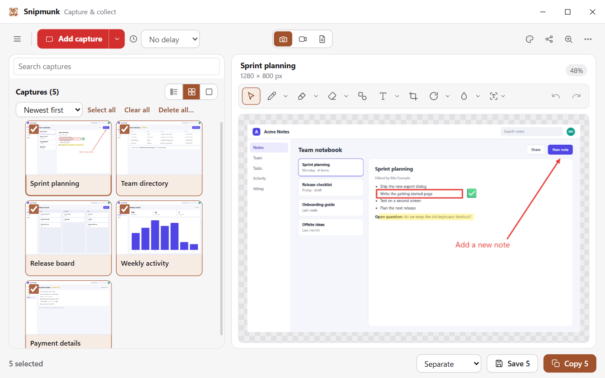

# Snipmunk user guide

Snipmunk is a free, open-source app for Windows that collects screenshots, records your screen and writes step-by-step guides.
Everything stays on your computer.

## Start here

| Page | What you learn |
|---|---|
| [Getting started](getting-started.md) | Install, first start, the three modes, the File menu, closing, updates |
| [Screenshots](screenshots.md) | Capture, collect, annotate, copy many pictures at once, save, search |
| [Text recognition and Quick redact](text-recognition.md) | Copy text and tables from a picture, hide private details |
| [Screen recording](recording.md) | Record, webcam bubble, cursor and click effects, trim, split, export |
| [Step-by-step guides](guides.md) | Every click becomes a step: record, edit, hide, save |
| [Templates and export](templates-and-export.md) | Covers, colours, pages, PDF, Word, Markdown, HTML |
| [Settings](settings.md) | Every settings page |
| [Keyboard shortcuts](shortcuts.md) | All shortcuts on one page |
| [Files and privacy](files-and-privacy.md) | Where your data is, what the file types contain, uninstall |
| [FAQ](faq.md) | SmartScreen, WebView2, PrintScreen, microphone, OCR languages and more |

The pictures in this guide show invented demo data in English, with the light theme.

[Back to the project page](../../README.md)
