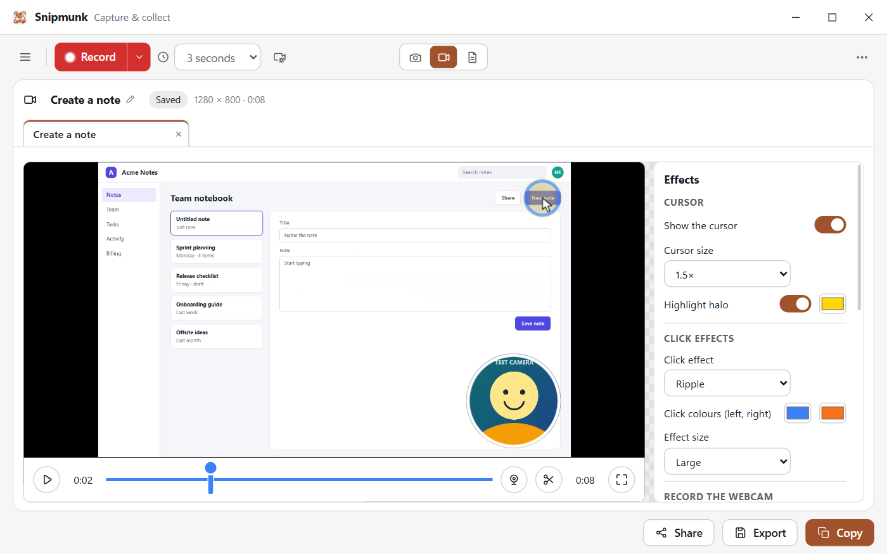
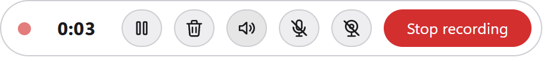
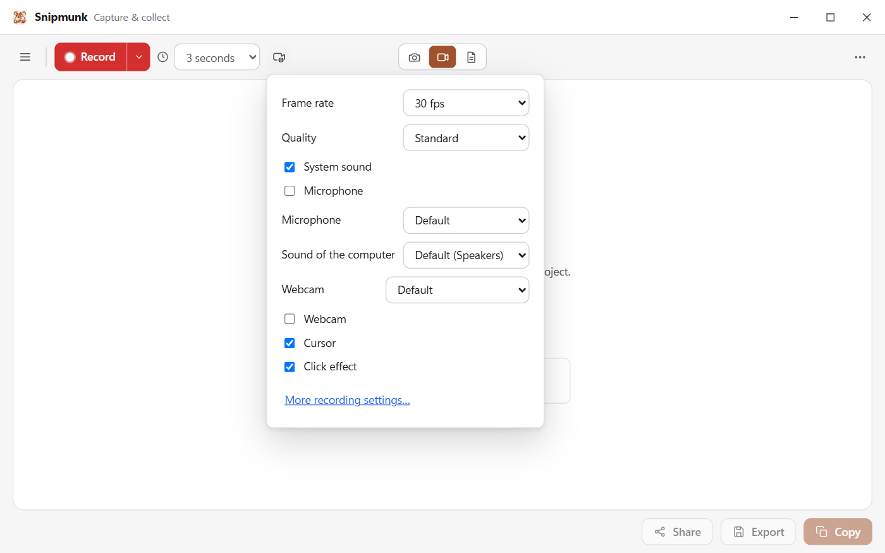
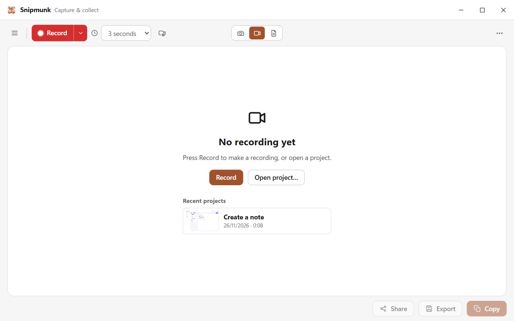
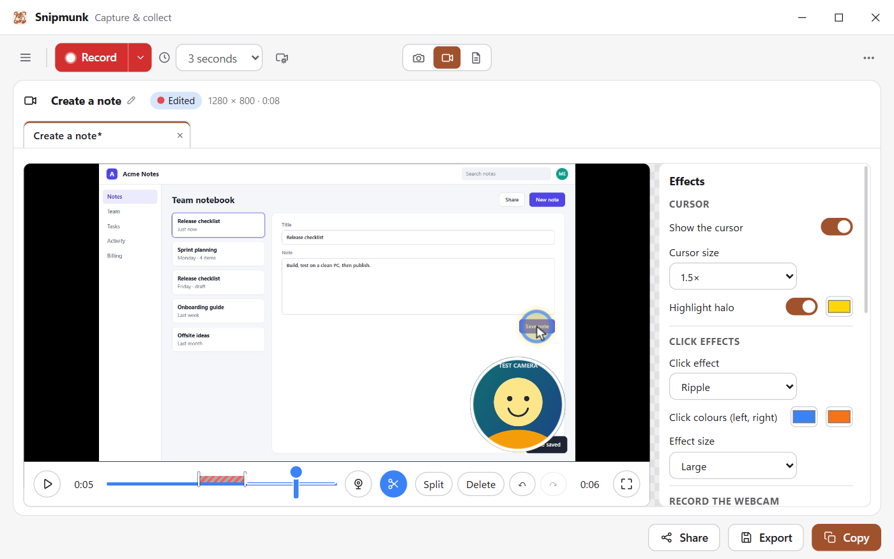
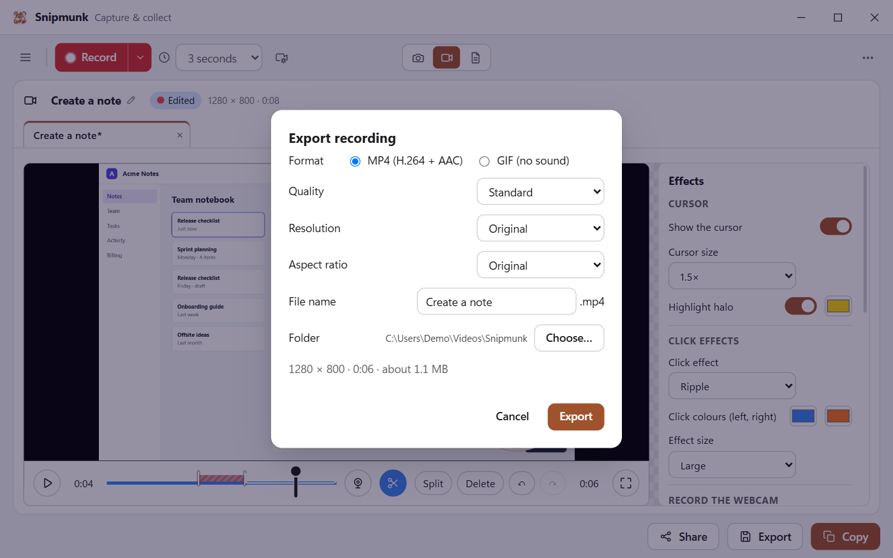

# Screen recording

[Guide overview](index.md)

Record your screen with sound, a webcam bubble and visible clicks, trim it and export it as MP4 or GIF. Switch to the
**Recording** mode (🎥) at the top.

## Record

1. Click **Record**, or press `Ctrl+Alt+R` in any program.
2. Choose what to record: an **area** (rectangle), a **window** or the **full screen** (the arrow next to Record).
3. A countdown runs (3 seconds at first; `Esc` cancels), then a red frame shows what is recorded and a small bar appears.
4. Press **Stop recording** on the bar, or `Ctrl+Alt+R` again.

On the bar you can **pause** (the pause is cut out), **discard**, and switch the system sound, the microphone and the webcam on or
off. The bar and Snipmunk's windows are not part of the video.

### Before you record

The button next to the countdown holds the quick options; all of them are also in [Settings → Recording](settings.md#recording).

| Option | Choices |
|---|---|
| Frame rate | 30 or 60 fps |
| Quality | Standard or High |
| System sound | What your computer plays (on at first) |
| Microphone | Your voice (off at first) |
| Webcam | Recorded as its own video, so you can still move it afterwards |
| Cursor and click effect | Shown in the video; changeable afterwards |

If Windows blocks the microphone or the camera, see the [FAQ](faq.md#the-microphone-or-webcam-is-not-recorded).

### The webcam bubble

With the webcam on, a live bubble appears with the countdown. **Drag it** where you want it and size it with its handle before
the recording starts. It is not captured as part of the screen: its place becomes the webcam overlay of the recording, which you
can change later. (Resizing the bubble while the recording runs does not work reliably yet.)

## After recording

The new recording is shown at once. It is a **temporary** recording until you save it as a project; the header says
**Not saved**. A new recording replaces it, so Snipmunk asks first. If Snipmunk or Windows closes unexpectedly, it offers to
recover the recording at the next start.

With nothing on show, the Recording mode offers **Record**, **Open project…** and your recent projects:

## Watch it

- `Space` plays and pauses; `←` / `→` step one frame (`Shift`: one second).
- Click or drag on the timeline to move through the video. The button at the right shows it full screen.
- The sound of the computer and the microphone have their own mute buttons and volume sliders (for playback).

## Effects

The **Effects** panel changes how the recording looks, in the player and in every export. The video itself stays untouched.

| Group | Settings |
|---|---|
| Cursor | Show it, size 1× / 1.5× / 2×, highlight halo and its colour |
| Click effects | Off, Ripple or Burst; a colour for left and right clicks; small, medium or large |
| Webcam | Show it, circle / rounded square / rectangle, size, position, border, border colour |
| Webcam sync | If your lips and voice are out of step: clap once, then move the slider until they match |

You can also drag the webcam on the video, or use the webcam button in the timeline to move and resize it. **Reset to defaults**
brings back your defaults.

## Trim and split

Open the **scissors** button in the timeline.

- **Trim:** drag the start and end handles. Only the part between them is played and exported.
- **Split:** move to a place and press **Split** (`S`). Click a part and **Delete** (`Delete`) to cut it out; it is shown
  hatched, and **Restore** brings it back. `Ctrl+Z` / `Ctrl+Y` undo and redo.

Nothing is removed from the recording itself; you can change your mind later.

## Export, copy and share

Click **Export** at the bottom right.

| Setting | Choices |
|---|---|
| Format | **MP4** (H.264 video, AAC sound) or **GIF** (no sound) |
| Quality | MP4: High, Standard, Small. GIF: Low (smaller file) or High (clearer) |
| Resolution | Original, 1080p, 720p, 480p (never larger than the recording) |
| Aspect ratio | Original, 16:9, 9:16 or 1:1, with black bars or cropped |

The dialog shows the size of the picture, the length and the expected file size, warns about very large GIFs, and shows progress
with **Cancel**. **Copy** puts the video on the clipboard to paste into a chat or a folder; **Share** opens the Windows share
window. Both prepare the video first, so they may take a moment.

## Projects (.snpr)

A project keeps the recording **and** your edits in one file.

| To | Use |
|---|---|
| Save the current recording | **Save as project…** |
| Open a project | **Open project…** (`Ctrl+O`), the recent list, or double-click a `.snpr` file |
| Save changes | `Ctrl+S` |
| Keep the original and save a copy | **File → Save as…** |
| Close a project | `Ctrl+W`, the × on its tab or a middle click |

Open projects get their own **tabs** next to the current recording; `Ctrl+Tab` switches. A `*` after a name means unsaved
changes. Snipmunk keeps a journal of unsaved edits and offers to restore them after a crash. When you quit, it lists everything
that is not saved.

Projects and exports start in your **Videos\Snipmunk** folder unless you choose another one. An exported MP4 or GIF does not
count as saving the project. If the disk gets almost full while recording, Snipmunk warns you and, if needed, stops and keeps
what was recorded.

The format is open: see the [.snpr specification](../snpr-format.md).

Next: [Step-by-step guides](guides.md)
