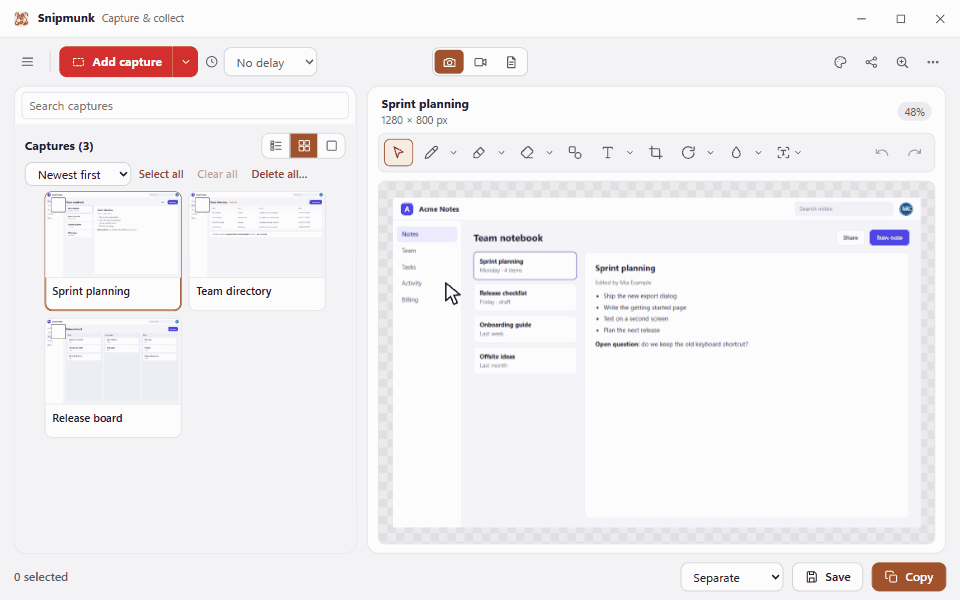
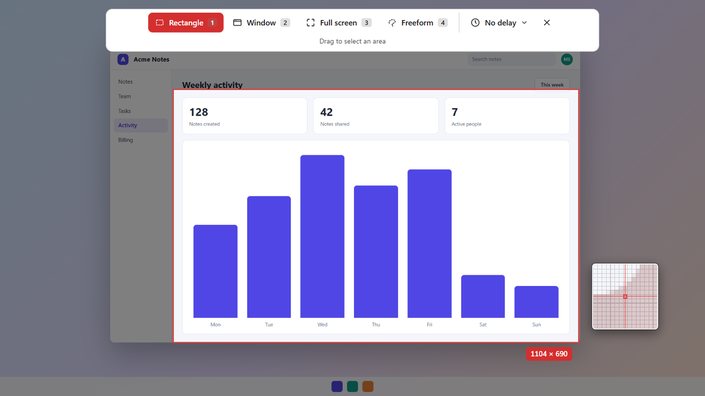
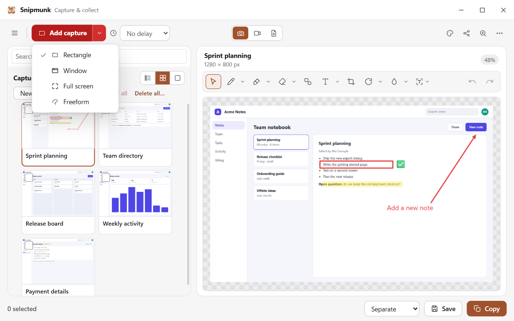
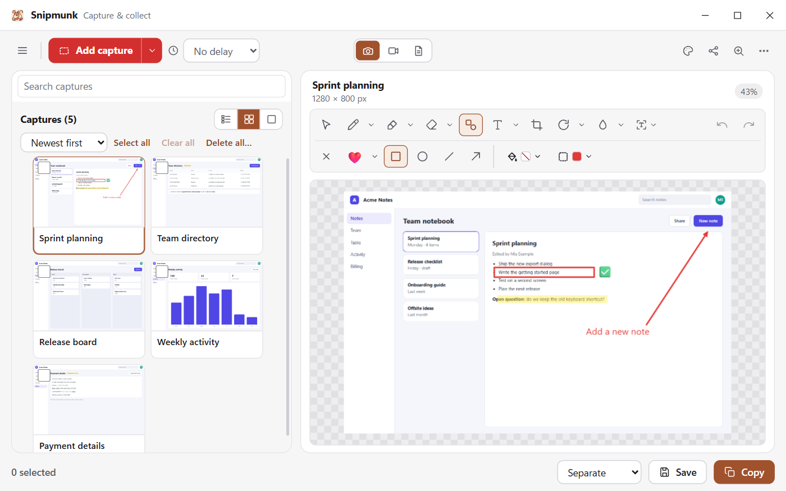
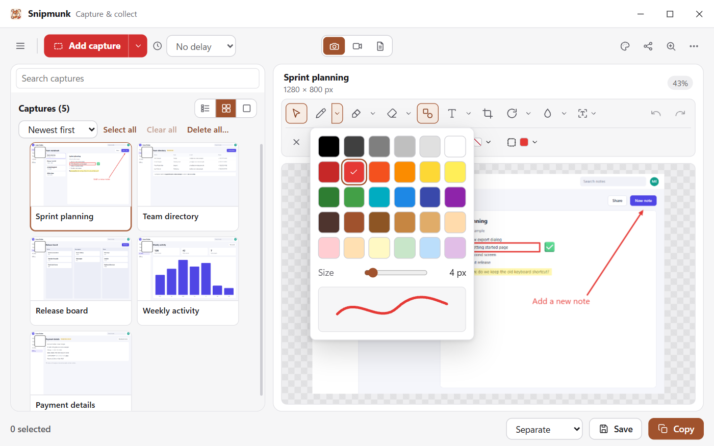
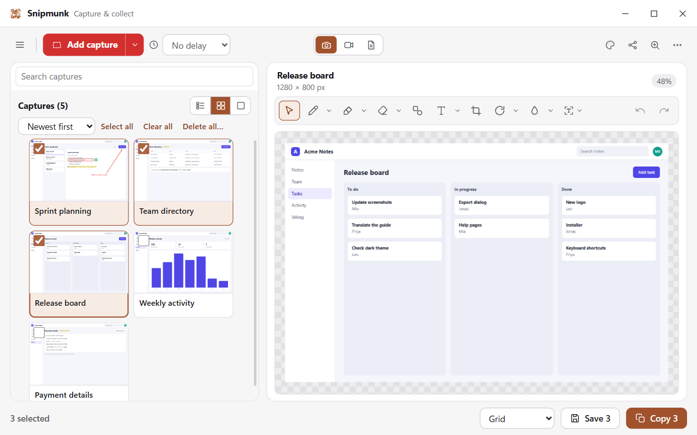
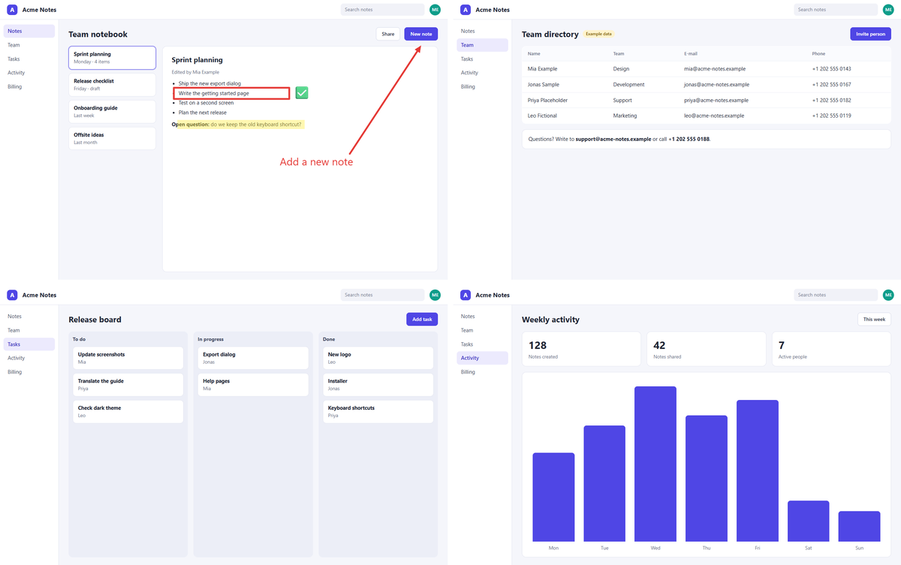
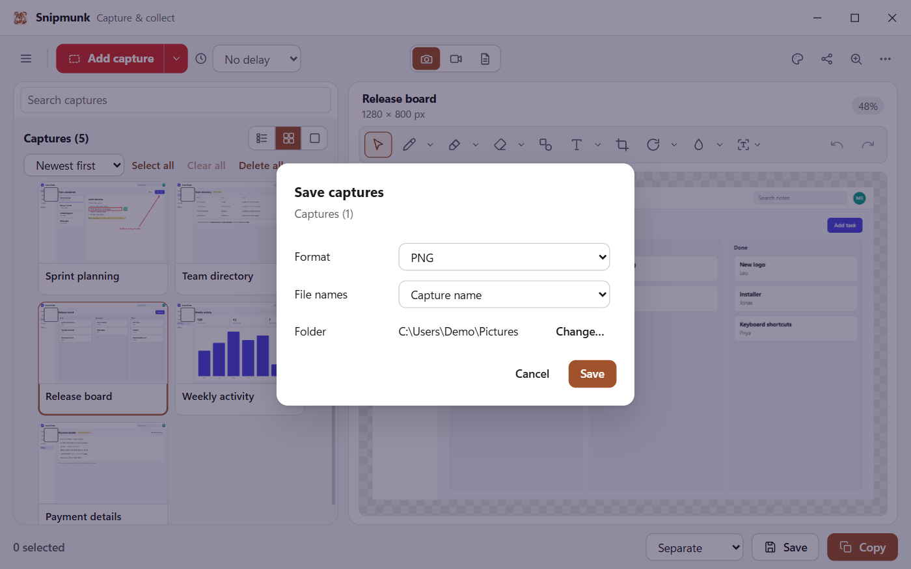
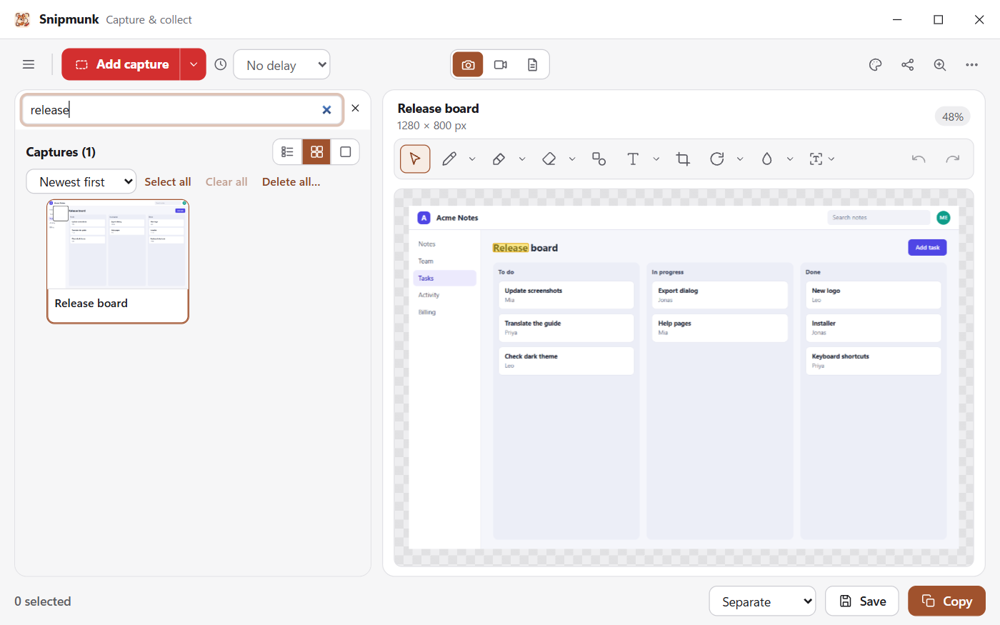

# Screenshots

[Guide overview](index.md)

Snipmunk is a screenshot **clipboard**: take as many captures as you like, mark them up, then paste all of them, or only the
ones you selected, in one go.

## Take a capture

1. Press `Ctrl+Alt+PrintScreen` in any program, or click **Add capture**.
2. The screen freezes and dims. Select what you want.
3. The capture is added to the list.

| Mode | Key | How |
|---|---|---|
| Rectangle | `1` | Drag a box. The size is shown in pixels. |
| Window | `2` | Click the window under the pointer. |
| Full screen | `3` | Click the monitor you want. |
| Freeform | `4` | Draw around the shape; everything outside becomes transparent. |

`Esc` or a right click cancels. A small magnifier next to the pointer helps you hit exact edges (switch it off in Settings →
Screenshots).

Choose the starting mode with the arrow next to **Add capture**:

### Delay

To capture something that only shows after a moment (a menu, a tooltip), choose a **delay** of 3, 5 or 10 seconds next to the
button or in the mode bar. The screen is grabbed after the countdown; `Esc` cancels it.

### After a capture

By default Snipmunk comes to the front and the new capture is also put on the clipboard. Both can be changed in
**Settings → Screenshots**: stay in the background with a notification, switch **Copy each capture to the clipboard** off, or
**Save each screenshot automatically** to a folder.

> If you want to hide private details first, switch **Copy each capture to the clipboard** off: the automatic copy is made
> before you have edited anything.

## The list

All captures are in one list on the left. They are saved at once, so they are still there after a restart or a crash.

- **Views:** list, medium thumbnails or large thumbnails (the three buttons above the list).
- **Sort:** newest first, oldest first or your own order. Drag a card to reorder.
- **Select:** click; `Ctrl`+click adds one; `Shift`+click selects a range; the check boxes do the same. `Ctrl+A` selects all,
  `Esc` clears the selection.
- **Rename:** `F2`, or right-click → Rename.
- **Right-click a card** for Rename, Duplicate, Copy, Save and Delete.
- **Delete:** `Delete`, the trash icon on a card, or **Delete all…**. Snipmunk asks first; deleting cannot be undone.
- **Add pictures you already have:** drag PNG, JPG, WebP, BMP or GIF files onto the list, or use **⋯ → Open file** (`Ctrl+O`).

How long captures are kept is your choice: see [Settings → Sessions](settings.md#sessions).

## Annotate

Select a capture; the tools are above the picture. The letter in brackets chooses the tool.

| Tool | What it does |
|---|---|
| **Select** (`V`) | Move, resize, rotate and restyle marks; select several |
| **Pen** (`P`) | Draw freely. `Shift` draws a straight line. Hold still at the end of a stroke to turn it into a clean shape |
| **Highlighter** (`H`) | A transparent marker |
| **Eraser** (`E`) | Remove single marks, or **Erase all mark-ups** |
| **Shapes** (`S`) | Rectangle, ellipse, line, arrow and emoji stickers, with fill and outline |
| **Text** (`T`) | Click to type. `Esc` or `Ctrl+Enter` finishes. A label background is optional |
| **Crop** (`C`) | Free or fixed aspect ratios; reset at any time |
| **Rotate** (`R`) | Rotate right or left, flip horizontally or vertically |
| **Blur** (`B`) | **Pixelate**, **Blur** or **Black box** over anything private |

Colours and sizes are in the small arrow next to each tool:

- **Undo / redo:** `Ctrl+Z` / `Ctrl+Y`.
- **Zoom and move:** the mouse wheel zooms at the pointer (or pans, if you choose "Scroll" in Settings → General);
  `Shift`+wheel pans sideways; hold `Space` or the middle button and drag. `Ctrl+0` is 100 %, `Ctrl+1` fits the window.
- Your original picture is never changed: marks, crop and rotation are kept next to it and applied to every copy and export.
  See [permanent redaction](text-recognition.md#apply-redactions-permanently) if the hidden pixels must not exist at all.

## Copy many pictures at once

1. Select the captures (or **Select all**).
2. Choose the **copy mode** at the bottom.
3. Click **Copy** and paste (`Ctrl+V`) into a document, a chat or an e-mail.

With nothing selected, **Copy** takes the capture you see.

| Mode | You paste |
|---|---|
| **Separate** | Each capture as its own picture (also as files, so a folder or a chat can take all of them) |
| **Stack** | One tall picture, one capture below the other |
| **Grid** | One picture with the captures in columns |

What **Grid** makes of four captures:

Pictures are copied in the order of the list. Programs differ in what they accept from the clipboard; if one takes only a single
picture, use **Stack** or **Grid**.

## Drag out, save, share, print

- **Drag** a card (or a selection) out of the window to drop PNG files into a folder, an e-mail or a chat.
- **Save** asks for the format (PNG, JPEG, WebP, BMP or a ZIP), the file names and the folder. Existing files are never
  overwritten.

- **Share** opens the Windows share window.
- **Edit in Paint** opens a copy of the capture in Paint.
- **Print** (`Ctrl+P`) prints one capture per page.

## Search

Type in the search box (`Ctrl+F`). Snipmunk looks in the capture names, the window titles and the **text inside the pictures**,
and marks the words it found.

Next: [Text recognition and Quick redact](text-recognition.md)
