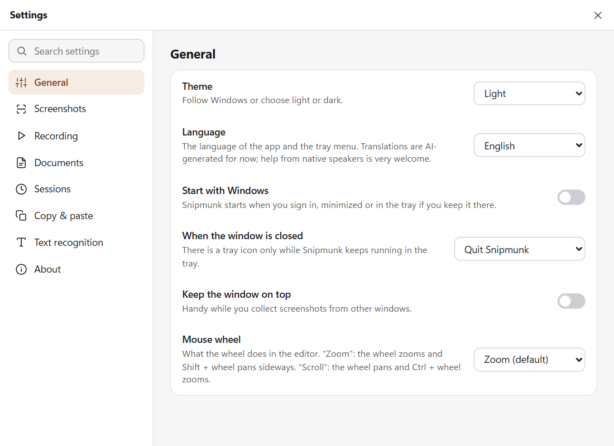
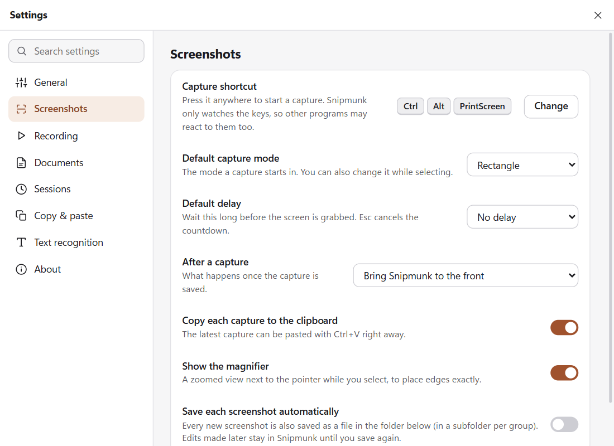
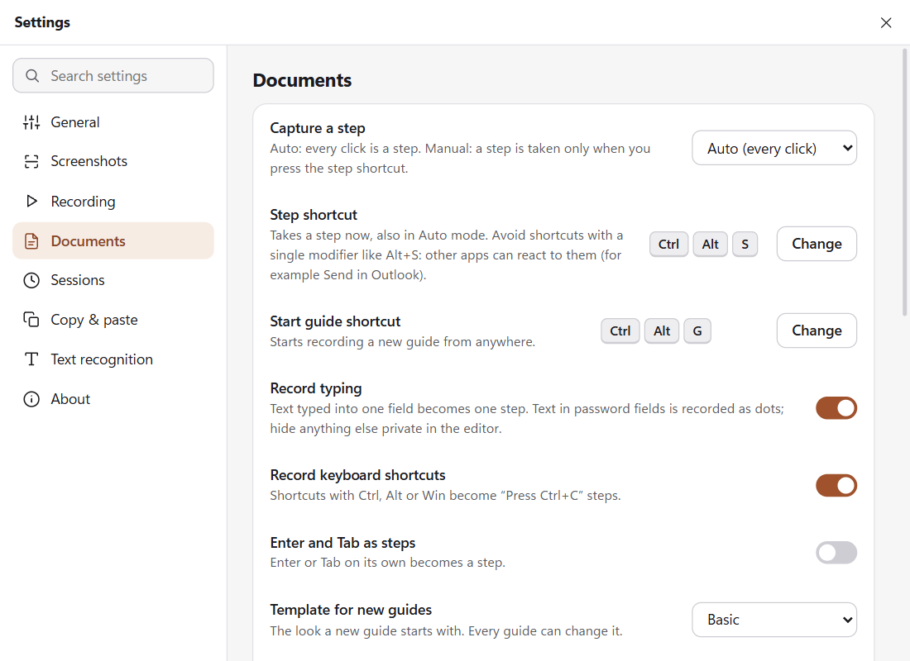

# Settings

[Guide overview](index.md)

Open **⋯ → Settings** (or **Settings** in the tray menu). The search box finds a setting by name and jumps to it.

## General

| Setting | What it does | At first |
|---|---|---|
| Theme | Follow Windows, light or dark | System |
| Language | The language of the app and the tray menu (12 languages) | System default |
| Start with Windows | Start at sign-in, minimized or in the tray | Off |
| When the window is closed | Quit, keep running in the tray, or ask | Quit |
| Keep the window on top | Handy while you collect from other windows | Off |
| Mouse wheel | In the editor: zoom (Shift pans) or scroll (Ctrl zooms) | Zoom |

## Screenshots

| Setting | What it does | At first |
|---|---|---|
| Capture shortcut | Starts a capture from any program | `Ctrl+Alt+PrintScreen` |
| Default capture mode | Rectangle, Window, Full screen or Freeform | Rectangle |
| Default delay | None, 3, 5 or 10 seconds | None |
| After a capture | Bring Snipmunk to the front, or stay in the background with a notification | Front |
| Copy each capture to the clipboard | Paste the latest capture at once | On |
| Show the magnifier | A zoomed view while you select | On |
| Save each screenshot automatically | Also save every new capture as a file | Off |
| Screenshot folder, File names | Where and how automatic saving writes (shown when it is on) | Pictures\Snipmunk |

To change a shortcut, click **Change** and press the new keys: `Ctrl`, `Alt`, `Shift` or `Win` with a letter, a digit, an F key
or PrintScreen. Snipmunk warns when Windows or other programs use the same keys.

## Recording

| Setting | What it does | At first |
|---|---|---|
| Recording shortcut | Starts and stops a recording | `Ctrl+Alt+R` |
| Default folder for projects and exports | Where "Save as project…" and Export start | Videos\Snipmunk |
| Microphone, Sound of the computer | Which devices are recorded | Windows default |
| Frame rate, Quality | 30 or 60 fps; Standard or High | 30 fps, Standard |
| Countdown | Before a recording **and** a guide | 3 seconds |
| System sound, Microphone | Recorded or not | On, Off |
| Cursor and click effects | The defaults of new recordings | Cursor shown, Ripple |
| Record the webcam, Webcam, shape, size, position, border | The webcam overlay | Off |

## Documents

| Setting | What it does | At first |
|---|---|---|
| Capture a step | Auto (every click) or Manual (step shortcut only) | Auto |
| Step shortcut, Start guide shortcut | Take a step; start a new guide | `Ctrl+Alt+S`, `Ctrl+Alt+G` |
| Record typing | Typing becomes steps (password fields show dots) | On |
| Record keyboard shortcuts | Shortcuts become steps | On |
| Enter and Tab as steps | | Off |
| Template for new guides | The look a new guide starts with | Basic |
| Step picture | Active window or full screen | Active window |
| Zoom into the click by default | Show a closer view around the click | Off |
| Click marker colours, shape, size; Step number | How clicks and numbers are drawn | Circle, medium |
| Keep full screenshots in guide files | Keep the whole screenshot in `.snpd` files | Off |
| Default folder for guides | Where "Save as…" starts | Documents\Snipmunk |

## Sessions

| Setting | What it does | At first |
|---|---|---|
| Capture list view | List, medium or large thumbnails | List |
| Export folder | Where saved screenshots go; empty asks each time | Empty |
| Clear the session on exit | Delete the captures when Snipmunk quits (recordings are never deleted this way) | Off |
| Keep old sessions | Older, no longer used screenshot sessions are deleted at start. Your current list is never deleted by this | 30 days |

## Copy & paste

**Default copy mode:** Separate, Stack or Grid (see [Screenshots](screenshots.md#copy-many-pictures-at-once)).

## Text recognition

| Setting | What it does |
|---|---|
| Engine | Windows text recognition, on your computer |
| Recognize text automatically after capturing | Reads new captures in the background (on at first) |
| Languages to read | Automatic, or one installed language |
| Installed languages | With a button that opens the Windows language settings |
| Models | None needed |
| Quick redact | Which types Quick redact covers |
| Words to always redact | Your own words, optionally whole words only |

## About

The version, **Check for updates**, **Check for updates automatically** (on at first), links to GitHub, the license and
translation help. The Microsoft Store version is updated by the Store.

Next: [Keyboard shortcuts](shortcuts.md)
