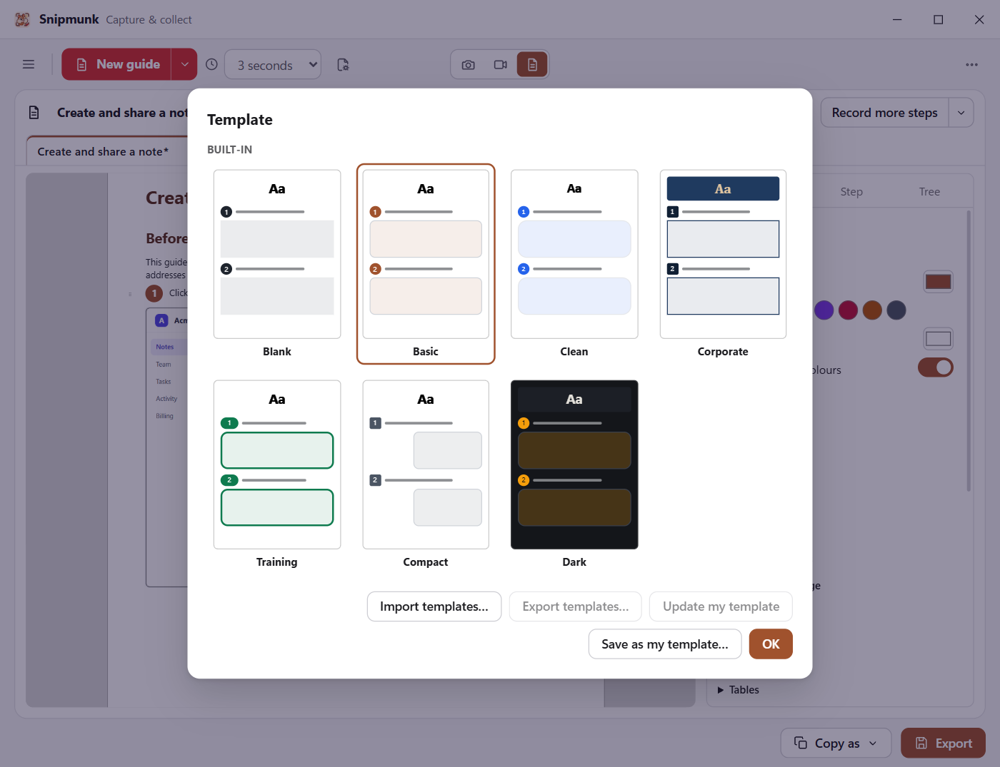
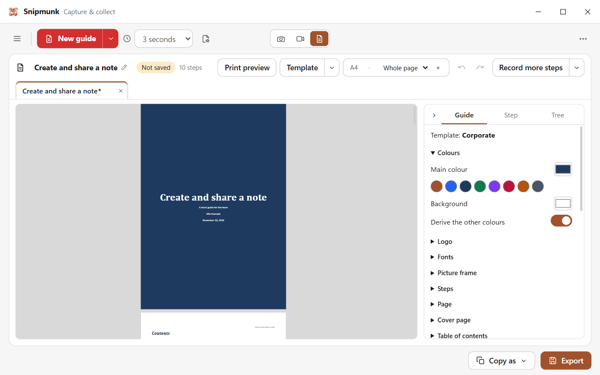
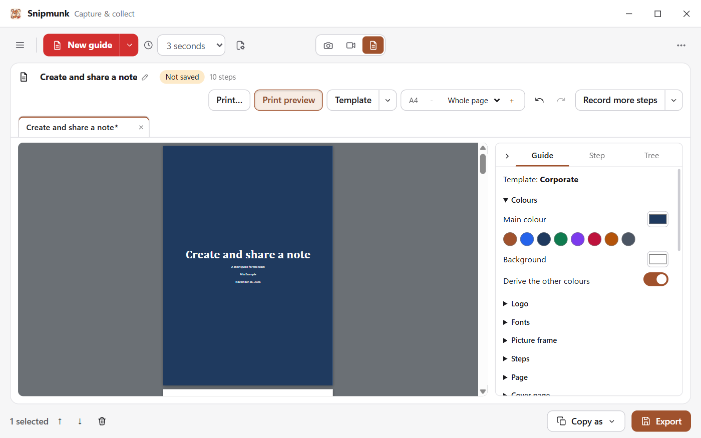
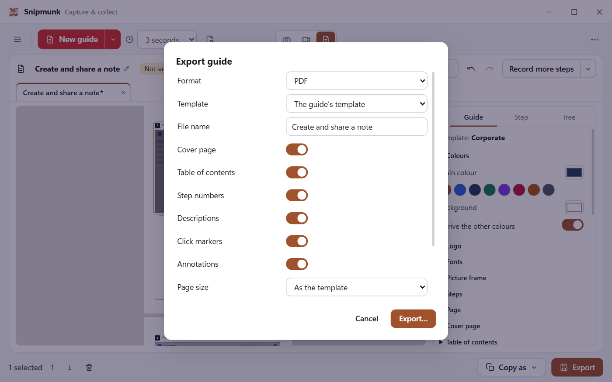
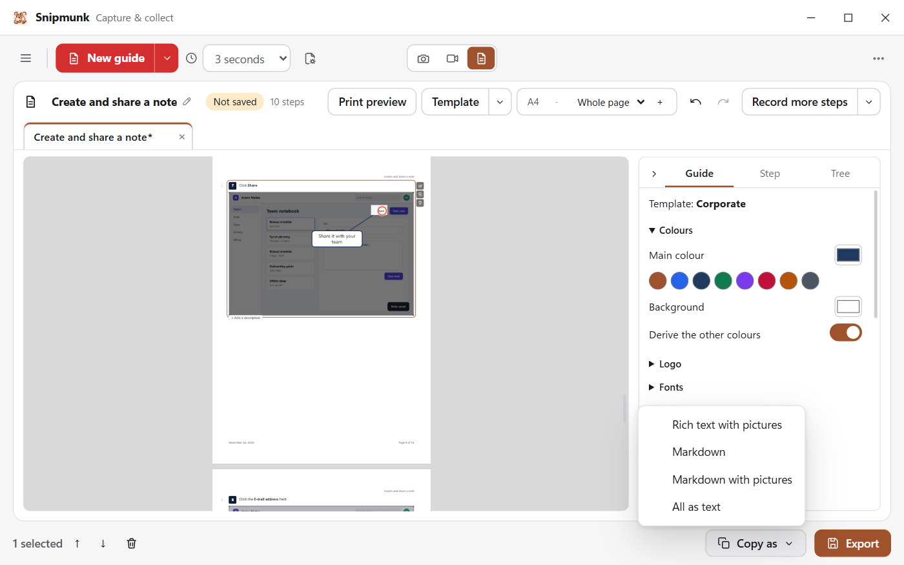

# Templates and export

[Guide overview](index.md)

A **template** decides how a guide looks in the editor, in print and in every export.

## Choose a template

Click **Template** above the pages. Changing template keeps what you wrote.

| Template | |
|---|---|
| **Basic** | The starting look: A4, Segoe UI |
| **Blank** | No cover, header, footer, background or frame |
| **Clean, Corporate, Training, Compact, Dark** | Ready-made looks |
| **My templates** | Your own |

The template a **new** guide starts with is set in Settings → Documents.

## Change the look

Everything is in the sidebar's **Guide** tab. Changes belong to this guide only.

| Section | What you can set |
|---|---|
| Colours | A main colour (the others can be derived from it), background, link, heading and text colours |
| Fonts | Heading and text font, sizes |
| Logo | Your picture, on the cover and in header or footer |
| Page | A4, Letter or Screen (no pages), portrait or landscape, margins |
| Steps | Text above or beside the picture, spacing, description style, one step per page, step number style and colours |
| Picture frame | Original, 16:9, 4:3, 3:2, 1:1 or your own ratio; picture width |
| Picture style | Border, corner radius, shadow; default drawing colour |
| Tables | Header row colour, borders, alternating rows |
| Header and footer | Left, centre and right: nothing, title, your text, logo, page numbers, date or author |
| Background image | On the cover, all pages or all but the cover; size, position, opacity, greyscale |

With a picture frame, drag the picture of a step to move it, or zoom with `Alt`+wheel; **Fit** and **Fill** are in the Step tab.

## Cover page and contents

Switch **Show a cover page** on and write the title, subtitle and author directly on the page.

- **Six cover designs:** Classic, Side band, Top banner, Full image, Minimal, Split. Adjust the text position, alignment, logo
  place and size.
- **Table of contents:** four styles (Classic, Modern, Formal, Simple), dot, dash or line leaders, page numbers, which steps and
  headings are listed.

## Your own templates (.snpt)

The arrow next to **Template** (or the buttons in the gallery) offers:

- **Save as my template…** and **Update my template**
- **Export templates…**: each becomes a `.snpt` file you can share
- **Import templates…**; double-clicking a `.snpt` file also asks to import it
- **Manage templates…**: rename, duplicate and delete

A template file holds its settings and its pictures (logo, background). It never holds the text or the screenshots of a guide.

## Pages, preview and print

With a page size the editor shows real pages, with header, footer and page numbers. Zoom with `Ctrl`+wheel, `Ctrl+0` for
100 %, or choose **Fit page width** or **Whole page**.

**Print preview** shows the finished pages; **Print…** (`Ctrl+P`) opens the Windows print dialog.

## Export

Click **Export** (`Ctrl+E`) at the bottom.

| Format | Result |
|---|---|
| **PDF** | Pages as in the print preview |
| **Word (.docx)** | An editable document with pictures, a contents field, header and footer |
| **Markdown** | A `.md` file with its pictures, or one ZIP; steps as a numbered list or headings; optional front matter |
| **HTML** | One self-contained web page |

You can pick another template for this export only, and leave out the cover, contents, step numbers, descriptions, click
markers or annotations. PDF and Word also offer page size, orientation and picture quality (lossless or smaller JPEG).

Word cannot reproduce a few details of the cover designs and contents exactly.

## Copy as

**Copy as ▾** puts the guide (or the selected blocks) on the clipboard:

Next: [Settings](settings.md)
