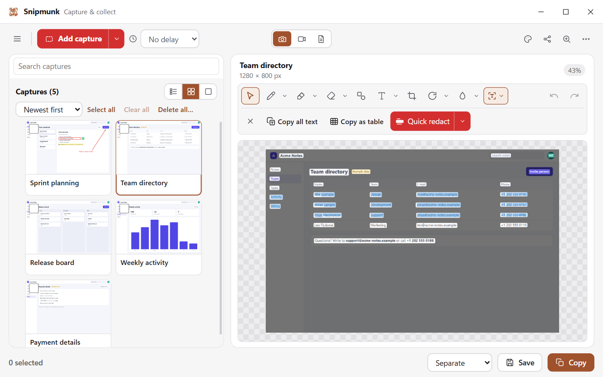
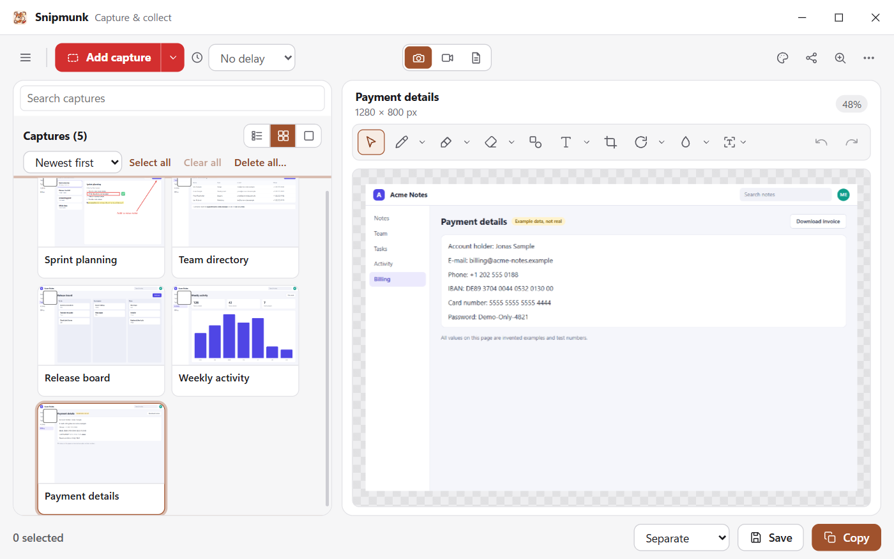
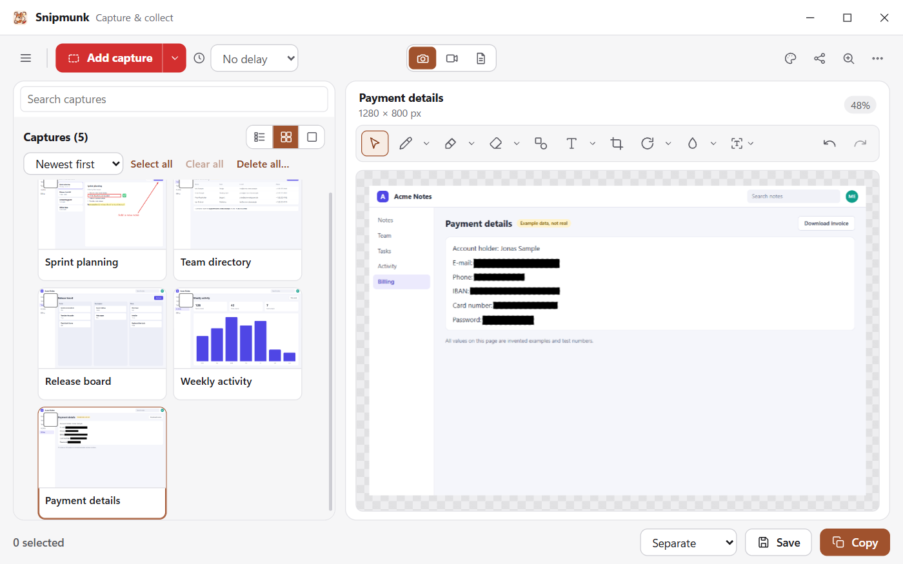
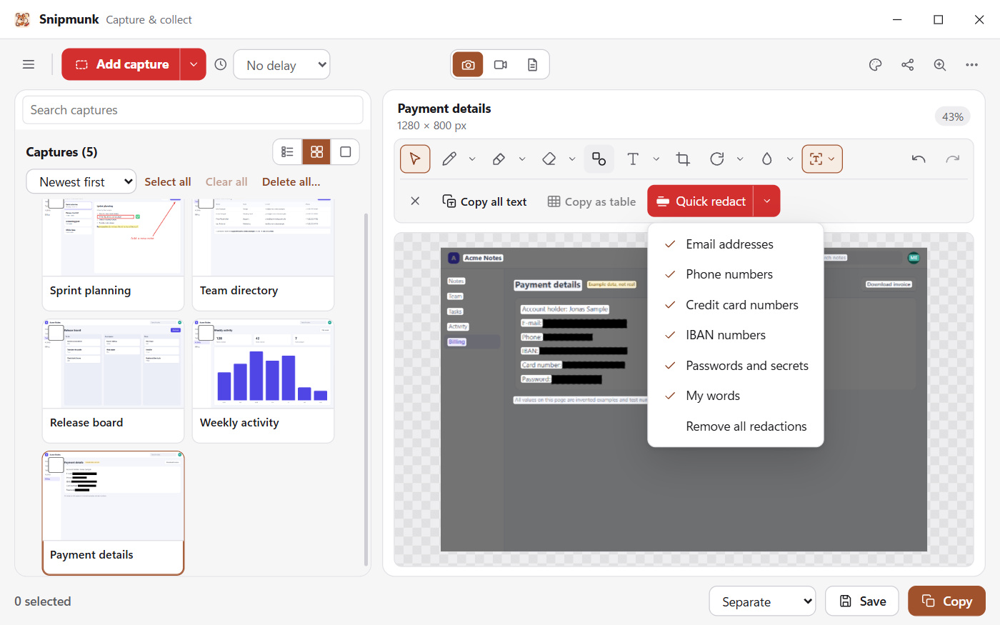

# Text recognition and Quick redact

[Guide overview](index.md)

Snipmunk reads the text in your captures with the text recognition that comes with Windows. It runs on your computer: nothing is
uploaded and nothing has to be downloaded. New captures are read quietly in the background (you can switch this off in
Settings → Text recognition).

## Text actions

Click **Text actions** in the toolbar. The picture dims and the recognized text stays bright.

| You want | Do this |
|---|---|
| All the text | **Copy all text** |
| A part of it | Drag over the words, or double-click a word, then `Ctrl+C` |
| A table, for Excel or Word | **Copy as table** (greyed out when no table is found) |
| More choices | Right-click the text: Copy, Copy all text, Select all, Redact only this, Always redact this |

Recognition can make mistakes, especially with small or thin lettering. Check what you copy.

## Quick redact

**Quick redact** covers private details with black boxes in one click.

| Before | After |
|---|---|
|  |  |

1. Click **Text actions**.
2. Click **Quick redact**.
3. Check the picture. One **undo** (`Ctrl+Z`) removes everything it added.

### What it finds

The arrow next to the button chooses the types (all on at first):

| Type | Notes |
|---|---|
| Email addresses | |
| Phone numbers | |
| Credit card numbers | 13 to 19 digits that pass the card checksum |
| IBAN numbers | Checked with the country, length and checksum rules |
| Passwords and secrets | The value after a label such as "Password:" (in all of Snipmunk's languages and common English words) |
| My words | Your own words and names |

Postal addresses are not detected.

> **Always check the result.** Quick redact can only cover what Windows managed to read. For example, Windows reads nothing in
> card numbers made of runs of ones, such as `4111 1111 1111 1111`. Cover anything it missed with the **Blur** tool.

### Your own words

Add words in **Settings → Text recognition → Words to always redact**, or right-click a word in the picture and choose
**Always redact this**. "Whole words only" stops a short word from matching inside longer ones.

## Apply redactions permanently

A redaction (blur, pixelate or black box) is a mark on top of your picture. **Every copy, save, drag, share and print has the
pixels really replaced.** The picture Snipmunk keeps for you still holds the original, so you can undo.

To erase the covered pixels from the kept picture too, open the arrow next to **Blur** and choose **Apply redactions
permanently**. You can still undo until you close Snipmunk; after that it is final.

Remember the clipboard: with **Copy each capture to the clipboard** on, an unredacted copy is made right after the capture is
taken.

The recognized text of a capture is stored next to it, and is deleted when the capture is deleted, when its redactions change, or
when its picture is replaced.

## Other languages

Snipmunk reads the languages for which Windows has the **Optical character recognition** feature.

1. **Settings → Text recognition → Open Windows settings** (or Windows Settings → Time & language → Language & region).
2. Add the language, and make sure its optical character recognition feature is installed.
3. Open Snipmunk's settings again (restart Snipmunk if the language is not listed). Choose a language in "Languages to read",
   or leave **Automatic**.

Windows does not offer recognition for every script; Urdu, for example, may be missing.

Quick redact also works on a whole [step-by-step guide](guides.md#quick-redact-a-guide).

Next: [Screen recording](recording.md)
